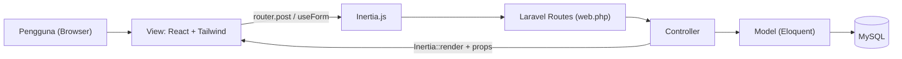
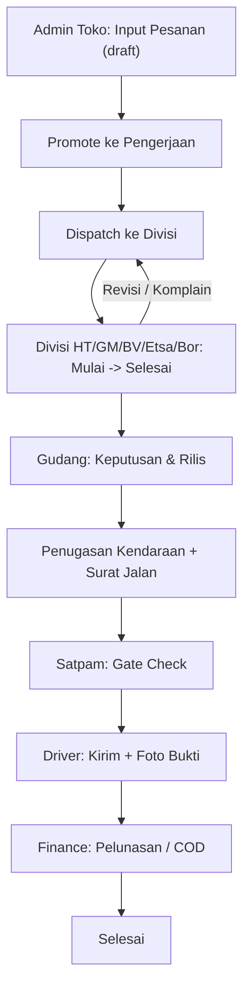
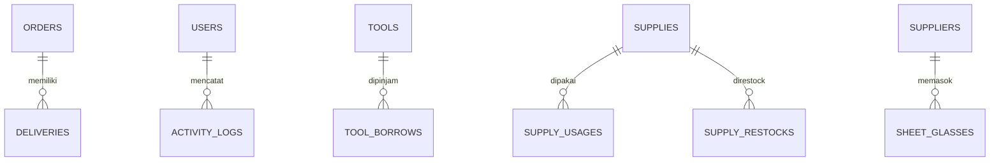

# Dokumentasi Proyek — System Magang Glassy
**Sistem Informasi Manajemen Operasional Pabrik & Toko Kaca**

---

## Daftar Isi
1. [Gambaran Umum](#1-gambaran-umum)
2. [Teknologi yang Digunakan](#2-teknologi-yang-digunakan)
3. [Arsitektur Sistem](#3-arsitektur-sistem)
4. [Hak Akses Pengguna (Role)](#4-hak-akses-pengguna-role)
5. [Modul & Fitur](#5-modul--fitur)
6. [Alur Bisnis Utama](#6-alur-bisnis-utama)
7. [Struktur Basis Data](#7-struktur-basis-data)
8. [Daftar Rute (Endpoint)](#8-daftar-rute-endpoint)
9. [Struktur Folder Proyek](#9-struktur-folder-proyek)
10. [Standar Desain Antarmuka](#10-standar-desain-antarmuka)
11. [Instalasi & Menjalankan Proyek](#11-instalasi--menjalankan-proyek)

---

## 1. Gambaran Umum

### 1.1 Latar Belakang
Pabrik dan toko kaca menjalankan banyak proses yang saling bergantung: penerimaan pesanan, pemotongan dan pemrosesan kaca di beberapa divisi produksi, pengelolaan stok, pengiriman ke pelanggan, sampai pencatatan keuangan. Kalau semua ini dicatat manual (kertas atau chat), datanya mudah hilang, sulit dilacak, dan tiap divisi tidak tahu status terbaru pesanan.

### 1.2 Tujuan Sistem
- Mencatat pesanan pelanggan secara terpusat dan terstruktur, termasuk perhitungan harga otomatis.
- Memantau progres produksi di tiap divisi (HT, GM, BV, Etsa, Bor) secara real-time.
- Mengelola stok kaca lembaran, kaca sisa (scrap/afval), aksesoris, alat kerja, dan bahan habis pakai.
- Mengatur pengiriman: surat jalan, penugasan kendaraan/driver, pemeriksaan satpam, dan bukti terima.
- Mencatat transaksi keuangan, pelunasan COD, dan laporan keuangan.
- Membatasi akses tiap pengguna sesuai perannya.

### 1.3 Ruang Lingkup
Aplikasi berbasis web yang dipakai secara internal oleh admin toko, divisi produksi, gudang, driver, satpam, bagian keuangan, dan owner.

---

## 2. Teknologi yang Digunakan

| Lapisan | Teknologi | Fungsi |
|---|---|---|
| Backend | **PHP 8.2+** | Bahasa pemrograman sisi server |
| Backend | **Laravel 11** | Framework MVC: routing, controller, Eloquent ORM, migration, autentikasi, validasi |
| Penghubung | **Inertia.js** | Menghubungkan Laravel dan React tanpa REST API terpisah |
| Frontend | **React 18** | Library UI berbasis komponen |
| Frontend | **Tailwind CSS 3 + PostCSS** | Styling berbasis utility class |
| Frontend | **lucide-react** | Ikon SVG |
| Database | **MySQL** | Penyimpanan data relasional |
| Build tool | **Vite 7** | Bundler aset JS/CSS dengan hot reload |
| Paket | **Composer** dan **npm** | Manajemen dependensi PHP dan JavaScript |
| Lingkungan | **Laragon** | Server lokal (web server, PHP, MySQL) |
| Versi kode | **Git & GitHub** | Kontrol versi (repo `System-Magang-glassy`) |
| Autentikasi | **Laravel Breeze** | Login, registrasi, reset password, profil |

---

## 3. Arsitektur Sistem

Sistem memakai pola **MVC (Model–View–Controller)** dengan **Inertia.js** sebagai jembatan (pola *modern monolith*).



**Alur request:**
1. Pengguna menekan tombol di React (misalnya "Simpan Order").
2. Inertia mengirim request ke rute Laravel.
3. Controller memvalidasi data, menjalankan logika bisnis, lalu menyimpannya lewat Model.
4. Laravel mengembalikan response Inertia, dan React memperbarui tampilan tanpa reload penuh.

**Pembagian komponen frontend (anti-monolitik):**
- `Pages/Dashboard.jsx` — orkestrator: state, sidebar, dan perpindahan tab.
- `Components/DashboardTabs/` — isi tiap tab/menu.
- `Components/Modals/` — semua pop-up form.

---

## 4. Hak Akses Pengguna (Role)

| Role | Tugas Utama |
|---|---|
| `owner` | Melihat semua data, ringkasan bisnis, laporan keuangan, persetujuan |
| `admin_toko` | Input pesanan, draft, revisi, mengirim pesanan ke produksi |
| `divisi_ht` | Proses Heat Treatment / Tempered |
| `divisi_gm` | Proses Gosok Mesin (poles tepi) |
| `divisi_bv` | Proses Bevel |
| `divisi_etsa` | Proses Etsa (sandblast/motif) |
| `divisi_bor` | Proses pengeboran lubang |
| `admin_gudang` | Stok kaca, scrap, aksesoris, alat, bahan habis pakai, keputusan gudang |
| `driver` | Menjalankan pengiriman, mengunggah bukti terima, klaim COD |
| `satpam` | Pemeriksaan kendaraan keluar (gate check / gate pass) |
| `admin_finance` / `finance` | Transaksi keuangan, approval, pelunasan COD, laporan |

Role disimpan di kolom `users.role`, dan tampilan menu menyesuaikan role yang sedang login.

---

## 5. Modul & Fitur

### 5.1 Dashboard Ringkasan — `DashboardOverviewTab`
Statistik pesanan, produksi, pengiriman, dan keuangan dalam bentuk kartu metrik.

### 5.2 Manajemen Pesanan — `OrdersTab`
- Membuat pesanan baru dengan banyak item kaca (`NewOrderModal`): jenis kaca, panjang, lebar, tebal, jumlah, proses, aksesoris, prioritas, deadline, dan foto sketsa.
- **Perhitungan harga otomatis**: luas (m²) = panjang × lebar ÷ 10.000, ditambah biaya proses, biaya prioritas, dan biaya custom.
- Status pembayaran: Lunas, DP, atau Tempo.
- Edit draft (`EditDraftOrderModal`) dan promosi draft ke pengerjaan (`PromoteOrderModal`).
- Penggunaan internal perusahaan (`is_company_use`).
- Cetak stiker kaca (`GlassStickerModal`) dan rekap penjualan (`SalesRekapModal`).

### 5.3 Produksi Divisi — `ProductionTab`
- Dispatch pesanan ke divisi (`DispatchModal`).
- Divisi menandai **mulai** dan **selesai** pekerjaan (`DivisionExecutionModal`), dan waktunya tercatat per divisi.
- Pencatatan pemakaian bahan baku (`raw_materials_used`).
- **Sistem revisi**: admin mengajukan revisi, pesanan dikunci saat diedit, lalu divisi mengonfirmasi (`RevisionDetailModal`).
- **Komplain cacat kaca** oleh divisi beserta penyelesaiannya (`ComplaintModal`).
- **Rekomendasi kaca sisa**: sistem menyarankan scrap yang ukurannya cocok, lalu dipakai atau ditolak (`ScrapPopupModal`).

### 5.4 Kaca Sisa / Scrap — `ScrapTab`
Pencatatan kaca sisa dengan kode, ukuran, lokasi rak, dan status (Layak Pakai, Terpakai, Afval/Baret).

### 5.5 Stok Kaca Lembaran & Supplier — `SuppliersTab`
- CRUD kaca lembaran dan restock (`AddStockModal`, `EditStockModal`, `RestockStockModal`).
- CRUD supplier dan pemesanan via WhatsApp (`SupplierWaModal`).

### 5.6 Aksesoris — `AccessoriesTab`
CRUD aksesoris dengan foto dan restock.

### 5.7 Alat Kerja — `ToolsTab`
CRUD alat, peminjaman, pengembalian (termasuk jumlah rusak), dan perbaikan (`BorrowToolModal`, `ReturnToolModal`, `CompleteRepairModal`).

### 5.8 Bahan Habis Pakai — `WarehouseSuppliesTab`
Pemakaian tunggal maupun batch, permintaan restock, serta approval atau pembatalan restock.

### 5.9 Pengiriman — `DeliveriesTab`
- Penugasan kendaraan/driver secara batch dan multi-alamat (`AssignVehicleModal`, `BatchWaybillModal`, `MultiAddressWaybillModal`).
- Surat jalan (`WaybillModal`) dengan warna Putih, Merah, atau Kuning.
- **Gate check satpam** (`GatePassModal`): status "Menunggu Cek Satpam" sebelum kendaraan keluar.
- Konfirmasi terkirim dengan foto bukti (`ConfirmDeliveryModal`) dan edit trip (`EditTripModal`).
- Klaim driver (`DriverClaimModal`).

### 5.10 Keuangan — `FinanceTab`
- Pemasukan dan pengeluaran (`FinanceTransactionModal`) dengan alur approval (pending, approved, rejected).
- Penyerahan uang COD dari driver (`CodSettlementModal`).
- Cetak laporan keuangan (`PrintFinancialReportModal`).

### 5.11 Karyawan — `EmployeesTab`
CRUD akun pengguna beserta role-nya (`EmployeeModal`).

### 5.12 Log Aktivitas
Setiap aksi penting dicatat ke tabel `activity_logs` untuk audit.

---

## 6. Alur Bisnis Utama



Status pesanan: `draft` → `pengerjaan` → `pengiriman` → `pembayaran` → `selesai`.

---

## 7. Struktur Basis Data

| Tabel | Keterangan |
|---|---|
| `users` | Akun pengguna dan role |
| `orders` | Pesanan: data pelanggan, item (JSON), proses, harga, status, progres divisi, revisi, komplain |
| `deliveries` | Pengiriman: nomor surat jalan, driver, plat, status, bukti, rute batch, gate check |
| `scrap_glasses` | Kaca sisa beserta lokasi rak |
| `sheet_glasses` | Stok kaca lembaran |
| `suppliers` | Data pemasok |
| `accessories` | Stok aksesoris |
| `tools`, `tool_borrows` | Alat kerja dan riwayat peminjaman |
| `supplies`, `supply_usages`, `supply_restocks` | Bahan habis pakai, pemakaian, dan restock |
| `finance_transactions` | Transaksi keuangan dan approval |
| `activity_logs` | Jejak aktivitas pengguna |

**Relasi utama:**


Perubahan struktur tabel dilakukan bertahap lewat file migration di `database/migrations/` (24 file, dari Agustus sampai September 2026).

---

## 8. Daftar Rute (Endpoint)

Semua rute operasional dilindungi middleware `auth` dan didefinisikan di `routes/web.php`.

| Grup | Contoh Rute | Controller |
|---|---|---|
| Dashboard | `GET /dashboard` | `SypOperationalController@dashboard` |
| Pesanan | `/orders`, `/orders/{id}/promote`, `/dispatch`, `/start-job`, `/finish-job`, `/revision` | `SypOperationalController` |
| Komplain | `/orders/{id}/complaint`, `/resolve-complaint` | `ComplaintController` |
| Scrap | `/scrap`, `/orders/{id}/use-scrap` | `ScrapController` |
| Pengiriman | `/orders/batch-delivery`, `/deliveries/{tripCode}/gate-check`, `/complete-delivery` | `SypOperationalController` |
| Keuangan | `/finance/transactions`, `/approve`, `/reject`, `/orders/{id}/settle-cod` | `SypOperationalController` |
| Karyawan | `/users` | `SypOperationalController` |
| Inventori | `/inventory/sheet-glasses`, `/suppliers`, `/accessories`, `/tools`, `/supplies` | `InventoryMasterController` |
| Profil & Auth | `/profile`, `/login`, `/register` | `ProfileController`, `Auth/*` |

---

## 9. Struktur Folder Proyek

```text
ProjectKP/
├── app/
│   ├── Http/Controllers/     # Logika bisnis (Syp, Inventory, Scrap, Complaint, Auth)
│   └── Models/               # 14 model Eloquent
├── database/migrations/      # Skema database bertahap
├── resources/
│   ├── css/                  # Tailwind entry
│   └── js/
│       ├── Pages/            # Dashboard, Auth, Profile
│       ├── Components/
│       │   ├── DashboardTabs/   # 12 tab menu
│       │   └── Modals/          # 44 pop-up modal
│       └── Layouts/
├── routes/web.php, auth.php  # Definisi rute
├── public/                   # Aset publik dan hasil build
├── docs/                     # Dokumentasi (file ini)
├── composer.json, package.json, vite.config.js, tailwind.config.js
```

---

## 10. Standar Desain Antarmuka

- Tema **Clean White Enterprise SaaS** tanpa dark mode.
- Warna UTB: Primary `#1b68b0`, Secondary `#70b03c`, Teks `#242222`.
- Ikon hanya dari `lucide-react`, tanpa emoji.
- Modal seragam: backdrop blur, kartu putih `rounded-3xl`, header dengan badge ikon, dan tombol tutup X.

---

## 11. Instalasi & Menjalankan Proyek

**Prasyarat:** PHP 8.2+, Composer, Node.js 18+, MySQL (Laragon).

```powershell
git clone <url-repo> ProjectKP
cd ProjectKP
composer install
npm install
copy .env.example .env
php artisan key:generate
# atur DB_DATABASE, DB_USERNAME, DB_PASSWORD di .env
php artisan migrate --seed
php artisan storage:link
npm run dev          # mode development
php artisan serve    # atau akses lewat virtual host Laragon
```

Build produksi: `npm run build`.

---
*Dokumen ini dibuat sebagai bagian dari laporan Kerja Praktik — Universitas Teknologi Bandung.*
